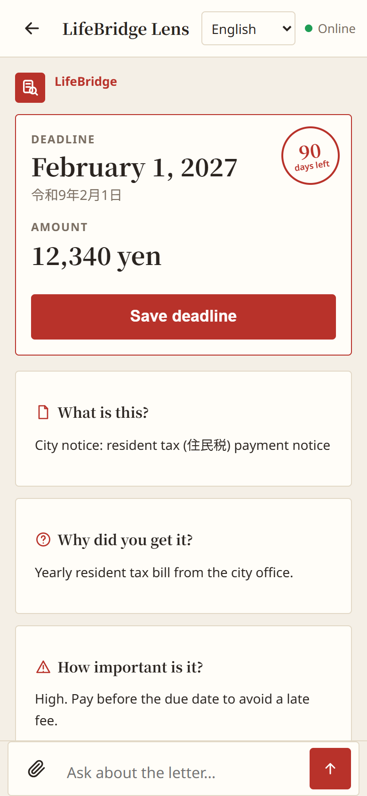
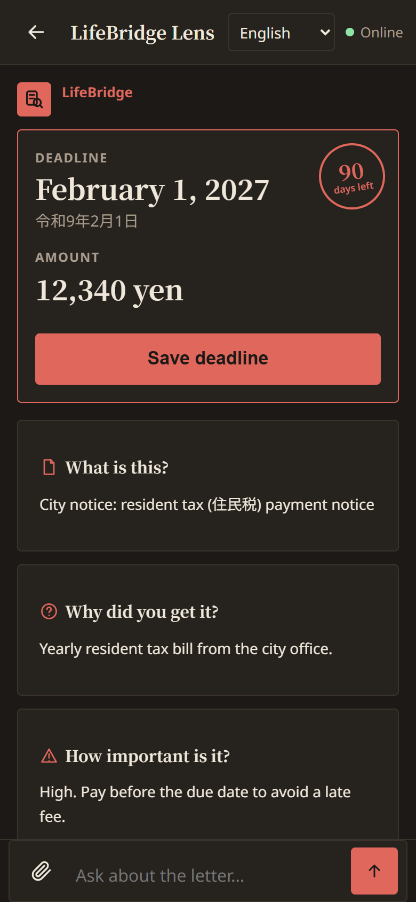
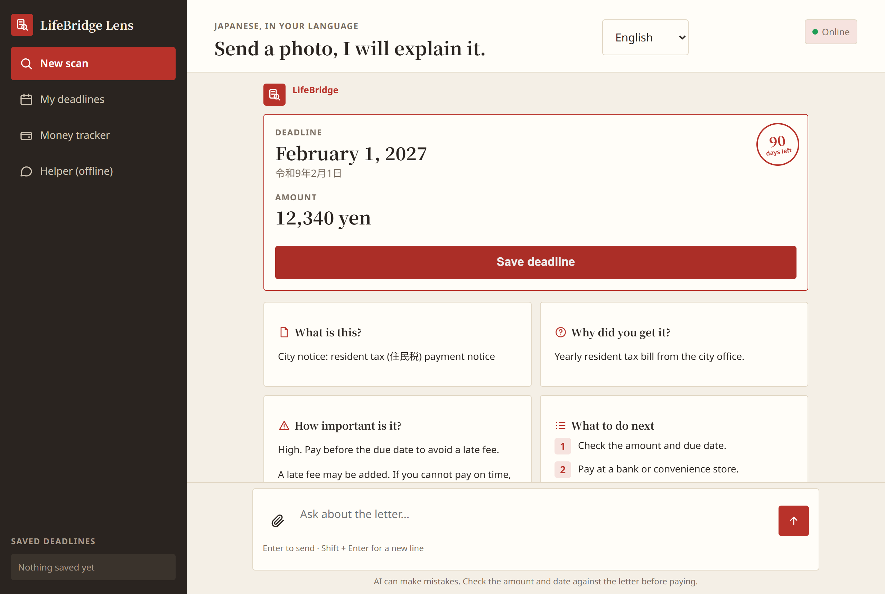

# LifeBridge Lens

Take a photo of any Japanese letter, machine, form or sign and understand it in your language.

## The problem

Newcomers in Japan get official letters they cannot read.
Tax bills, health insurance slips, pension papers and city hall notices arrive in Japanese only.
People miss deadlines, pay late fees, or ask friends to translate private papers.
Ticket machines, ATMs and paper forms are Japanese only too.

## What was built during the hackathon vs pre-existing

- **Pre-existing (not judged):** the LIFEGO guide website — guide articles,
  home, search, saved pages and settings. It is kept separately at
  https://github.com/Binod-in/lifebridge-japan and none of its code is in
  this repo.
- **Built this week (everything in this repo):** the Lens chat page
  (`explain.html`), the server (`server.py`), the deadlines page
  (`dates.html`), the money tracker (`tracker.html`), the landing page
  (`index.html`), the offline page (`offline.html`), the offline chatbot
  (`chatbot.js`), translations (`i18n.js`), the service worker (`sw.js`),
  the stylesheet (`style.css`), the PWA manifest and icons, the icon
  script (`scripts/`), and the test suite (`tests/`).

## How it works

1. Take or pick a photo of a letter, machine, form or sign.
2. Meta AI detects the kind: letter, machine, form, sign, or other.
3. You get an explanation in Nepali, English, Vietnamese or Burmese.
4. A deadline and amount box shows the due date with days left.
5. Save the deadline to My Deadlines or add it to your calendar.
6. Ask follow-up questions in the same thread, with step-by-step guides.

## Features

- Chat-style Lens page with one composer for photos and questions
- Auto detect for letters, machines, forms, signs and other photos
- Step-by-step guides for machines, payments and how-to questions
- Staff phrase with hiragana reading, Listen and practice sentences
- My Deadlines page with days left, saved in the browser
- Money tracker with income, spending, goals and AI advice on totals
- Offline helper and offline pages for transport, payments and emergencies
- UI in English, Nepali, Vietnamese and Burmese
- Light and dark Washi design
- Installable PWA with offline cache

## How LifeBridge uses Meta AI

- The **muse-spark-1.3** vision model reads the photo directly.
  There is no separate OCR step.
- The model must reply in strict JSON with 12 keys: `what`, `kind`,
  `why`, `importance`, `next_steps`, `deadline`, `amount`,
  `staff_phrase`, `staff_phrase_meaning`, `staff_reading`, `check` and
  `deadline_date`. The due date always comes back as `YYYY-MM-DD`.
- Each kind has its own rules. Machines get a numbered walkthrough of
  the visible buttons. Forms get one step per field. Signs get their
  meaning plus steps. Photos with nothing to do with daily life get
  kind `other`: a polite message only.
- Follow-up chat sends the photo again with the earlier explanation
  and up to 10 earlier turns, so every question stays about the
  same notice.
- Reasoning effort is `low` for scans and `minimal` for follow-ups
  and money advice (env vars `REASONING_EXPLAIN` and `REASONING_ASK`).
  Less reasoning is faster. Scans keep `low` because dates and amounts
  must stay correct. See Speed below.
- Reliability: each Meta call may take up to 60 s, inside an 85 s
  total budget, under the browser timeout of 90 s. Timeouts and
  server errors retry once, only when at least 30 s of the budget
  is left.
- Long letters: if the reply is cut off, the server still tries to
  parse it. If parsing fails, it retries once with shorter values.
  If that fails too, it returns a friendly error that asks for a
  photo of just the top part.
- The JSON parse is forgiving. It strips code fences and any text
  outside the first `{` and last `}` before parsing.
- If the API rejects the `reasoning_effort` field, the server retries
  once without it.

## Safety and honesty

- The app never invents amounts, dates or names. Unclear details come
  back empty with a note to check.
- Letter facts come only from the photo or the earlier explanation.
- General questions about life in Japan are answered from general
  knowledge and kept separate from letter facts.
- No medical or legal advice. Medicine and legal papers are explained,
  then the reader is sent to a pharmacist, doctor or the city office.
- The app never asks for card numbers or PINs. At ATMs it reminds
  users to cover the keypad.
- The photo is sent to Meta AI and not stored on our server.
- Saved deadlines and money entries stay in the browser. Only AI
  requests (photo plus question) leave it, to Meta AI.
- `LB_API_TOKEN` only blocks casual scripts. It is sent to every
  browser, so it is NOT a secret and NOT real authentication.

## Accuracy check
| Letter | Type | Deadline correct | Amount correct | Notes |
|---|---|---|---|---|
| Water and sewer bill (Shiki City) | Real letter | Yes | Yes | Nov 16, 2026 / 2,304 yen |
| Road repair notice | Real letter | N/A (information only) | N/A | Date and time correct, said "not a payment" |
| National Health Insurance payment slip | Synthetic sample | Yes | Yes | Did not confuse the barcode expiry date with the deadline |
| National Pension exemption rejected | Synthetic sample | N/A | N/A | Said the exemption was rejected, payment is still needed, and the 3-month appeal window |
| Water bill auto-debit failed | Synthetic sample | Yes | Yes | Nov 25, 2026 / 3,520 yen |
Real letters were tested with personal details covered. Synthetic samples are fictional (見本市, 見本 太郎) and labeled 見本.

## Speed (real iPhone tests on home Wi-Fi)
- Scan: about 11–27 s (most 11–21 s). Before tuning reasoning_effort: 28–37 s.
- Follow-up answer: 6–8 s. Before: about 19 s.

## Run locally

```powershell
python -m venv .venv
.\.venv\Scripts\Activate.ps1
pip install -r requirements.txt
copy .env.example .env
# Edit .env and set META_API_KEY (never commit .env)
python server.py
```

Then open http://127.0.0.1:5000/. The AI features need `META_API_KEY`,
everything else works without it.

`LB_API_TOKEN` (optional) only blocks casual scripts. It is sent to every
browser via `/lb-config.js`, so it is NOT a secret and NOT real
authentication.

## Run the tests

```powershell
.\.venv\Scripts\python.exe -m unittest discover tests -v
```

Tests use mocked AI replies and need no API key.

## Links

- Demo video: TODO
- Live demo: TODO

## Screenshots

All shots show the built-in sample notice, never a real letter.
Taken from the current light and dark Washi design.






